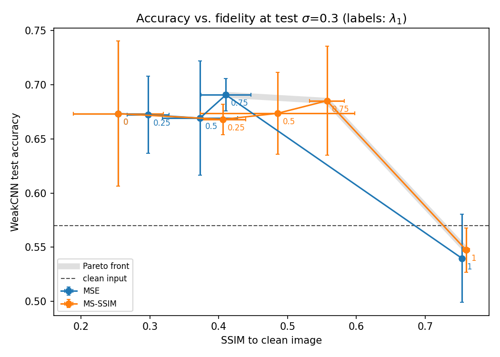
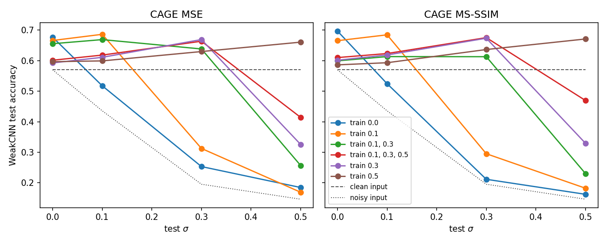
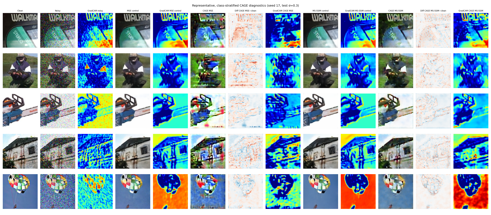

# CAGE: Classifier-Aware Generative Enhancement

[](https://colab.research.google.com/github/KadirKess/CAGE/blob/main/notebooks/CAGE.ipynb)

**Task-guided denoising.** A U-Net is optimised using the signal from a frozen classifier, and Grad-CAM is used to analyse the class-discriminative artefacts it introduces beyond denoising.

Train a denoiser against a frozen classifier, and it stops just removing noise. It starts adding signal the classifier can use. On Imagenette, the classifier is about 10 points more accurate on CAGE outputs than on the clean images themselves, even when the input contains no noise at all. The price is fidelity, since the outputs differ visibly from the clean images.

CAGE is built to exploit one specific classifier, WeakCNN, which is deliberately small and weak. The question is how far a denoiser can push that classifier's accuracy while its output stays recognisable as the original image. All results come from study v0.1, which trains 21 configurations with 3 seeds each.



*Figure 1. WeakCNN test accuracy against SSIM to the clean image at test $`\sigma = 0.3`$. Point labels give $`\lambda_1`$, and $`\lambda_1 = 1`$ is the reconstruction-only control.*

## Related work

[Liu et al. (IJCAI 2018)](https://arxiv.org/abs/1706.04284) already train a denoiser through a fixed high-level vision model, backpropagating a joint loss into the denoiser only so that denoising helps classification and segmentation. CAGE uses the same setup and asks what the denoiser does once its outputs are classified better than the clean images. [Salman et al. (NeurIPS 2021)](https://arxiv.org/abs/2012.12235) design *unadversarial* objects and textures that a fixed model classifies more confidently. CAGE's artefacts are an image-space counterpart of that idea, learned by a denoiser for all images instead of optimised for each object.

## Method

A U-Net $g_\phi$ denoises $\tilde{x} = x + \eta$, with $\eta \sim \mathcal{N}(0, \sigma^2 I)$, and is trained with

$$
\mathcal{L} = \lambda_1 \, \mathcal{L}_{\text{rec}}\big(g_\phi(\tilde{x}), x\big) + \lambda_2 \, \mathcal{L}_{\text{CE}}\big(f_\theta(g_\phi(\tilde{x})), y\big)
$$

where $f_\theta$ is a pretrained classifier with frozen weights. The cross-entropy gradient flows through $f_\theta$ into the U-Net, so the classifier acts as a differentiable critic. With $\lambda_2 = 0$ the U-Net is an ordinary denoiser, which we call the *control*, and with $\lambda_1 = 0$ only the classifier constrains it.

The reconstruction term decides what "close to the original" means. We compare MSE, which measures per-pixel fidelity, with $1 - \text{MS-SSIM}$ (from `pytorch-msssim`), which measures multi-scale structural fidelity.

**Models.** Both networks are small, so differences between runs come from the loss rather than capacity. WeakCNN has two unpadded 3x3 convolution blocks with ReLU and max pooling (3 to 8 to 16 channels) and a linear head, and its 30x30 last feature map keeps Grad-CAM maps spatially readable. The U-Net has three levels (16, 32 and 64 channels), a 128-channel bottleneck, double convolution blocks with batch normalisation, skip connections and transposed-convolution upsampling.

**Data.** [Imagenette](https://github.com/fastai/imagenette) gives 10 ImageNet classes at 128x128 RGB, and natural photographs let a reader judge whether an output still looks right. We train on the official training split and divide the official validation split per class into a validation half for model selection and a test half for every reported number.

**Protocol.** Each seed trains one WeakCNN on clean images, then every denoiser of that seed against it (Table 1). Training noise is $\sigma = 0.3$ unless stated otherwise, and at test time all models see the same noise draws at $\sigma \in \{0, 0.1, 0.3, 0.5\}$. We report WeakCNN accuracy and SSIM to the clean image as means over 3 seeds with 95% Student-t intervals, and compare models in pairs within each seed. Training details are in [docs/reproducing.md](docs/reproducing.md).

*Table 1. Study configurations, each trained once with MSE and once with MS-SSIM.*

| Experiment | Configurations |
|---|---|
| Control | $\lambda = (1, 0)$ |
| Main | $\lambda = (0.5, 0.5)$ |
| Loss-weight sweep | $\lambda_1 \in \{0, 0.25, 0.75\}$, $\lambda_2 = 1 - \lambda_1$ |
| Noise study | $\lambda = (0.5, 0.5)$, trained at $\sigma$ = 0, 0.1, 0.5, {0.1, 0.3} and {0.1, 0.3, 0.5} |

## Results

### Comparison with clean and noisy inputs

Every CAGE model is more accurate than WeakCNN on the clean images, on every seed, while the controls stay 0.02 to 0.03 below them (Table 2). Paired against the clean images, CAGE MS-SSIM at $\lambda = (0.5, 0.5)$ gains 0.095, 0.124 and 0.092 on the three seeds, and CAGE MSE at $\lambda = (0.75, 0.25)$ gains 0.128, 0.125 and 0.110. SSIM to the clean image, meanwhile, falls from about 0.75 for the controls to 0.37 to 0.56 for CAGE.

*Table 2. WeakCNN test accuracy and SSIM to the clean image at test $`\sigma = 0.3`$.*

| Input to WeakCNN | Accuracy | SSIM to clean |
|---|---|---|
| Clean | 0.570 | 1.000 |
| Noisy | 0.195 | 0.157 |
| MSE control | 0.540 | 0.753 |
| MS-SSIM control | 0.547 | 0.760 |
| CAGE MSE, $\lambda = (0.5, 0.5)$ | 0.669 | 0.373 |
| CAGE MS-SSIM, $\lambda = (0.5, 0.5)$ | 0.674 | 0.486 |
| CAGE MSE, $\lambda = (0.75, 0.25)$ | **0.691** | 0.410 |
| CAGE MS-SSIM, $\lambda = (0.75, 0.25)$ | 0.685 | **0.557** |

### Training without noise

The models trained and tested at $\sigma = 0$ give the most direct evidence that CAGE adds information instead of recovering it. Their input is the clean image, so there is nothing to denoise, yet accuracy rises from 0.570 to 0.677 with MSE and 0.697 with MS-SSIM, on every seed. Their outputs keep an SSIM of 0.47 and 0.68 with the very image they received.

### Effect of the loss weights

Accuracy stays between 0.67 and 0.69 for every $\lambda_1$ from 0 to 0.75, then drops to the control's 0.54 at $\lambda_1 = 1$, while SSIM rises steadily with $\lambda_1$ (Figure 1). The setting $\lambda = (0.75, 0.25)$ therefore beats $(0.5, 0.5)$ on both axes, on every seed and for both reconstruction terms, and the Pareto front runs through the two $\lambda_1 = 0.75$ points and the MS-SSIM control.

The drop is abrupt because the two terms have very different scales. At the best epoch, the weighted reconstruction term is about 0.017 for MSE and 0.07 to 0.09 for MS-SSIM, against 0.28 to 0.57 for the weighted cross-entropy, so cross-entropy dominates every $\lambda_1 < 1$ tested here. Balancing them would take $\lambda_2 / \lambda_1$ around $10^{-2}$ or below, which this sweep does not reach.

### MSE and MS-SSIM reconstruction terms

At $\lambda = (0.5, 0.5)$, replacing MSE with MS-SSIM leaves accuracy unchanged (+0.004, within seed variation) and raises SSIM by 0.113, between 0.077 and 0.170 depending on the seed. This study cannot separate two explanations for the gap. SSIM is close to what the MS-SSIM branch optimises, and the MS-SSIM term is also 4 to 5 times larger than the MSE term at the same $\lambda$, so it constrains the output more.

### Generalisation across noise levels

The denoisers handle less noise than they saw during training, but not more (Figure 2). Models trained at $\sigma = 0$ or 0.1 fall to 0.21 to 0.31 accuracy at test $\sigma = 0.3$, close to the 0.195 measured on noisy inputs. Training on all three levels keeps the $\sigma = 0.3$ performance, but at $\sigma = 0.5$ it reaches only 0.41 with MSE and 0.47 with MS-SSIM (intervals of ±0.17), against 0.66 and 0.67 for the models trained at $\sigma = 0.5$.



*Figure 2. WeakCNN test accuracy against test $`\sigma`$ for each training-noise schedule, with $`\lambda = (0.5, 0.5)`$.*

### Qualitative results

The artefacts are easy to see (Figure 3). CAGE MSE outputs carry saturated colour blotches and broken textures, while CAGE MS-SSIM outputs stay recognisable but visibly altered, and both difference maps show the checkerboard patterns typical of transposed-convolution upsampling. Recognisability is judged here by eye only, since SSIM measures distance to the clean image rather than whether a person can still tell what it shows. A blind labelling test would measure it directly.



*Figure 3. Test images at $`\sigma = 0.3`$ (seed 17), with the control and CAGE outputs at $`\lambda = (0.5, 0.5)`$, their difference with the clean image, and the WeakCNN Grad-CAM maps.*

### Grad-CAM analysis

On CAGE outputs, WeakCNN's Grad-CAM maps move to new regions that follow the edit, and the evidence WeakCNN already used grows, yet the edit itself is not concentrated on the regions WeakCNN looked at (Table 3). All Grad-CAM maps come from WeakCNN's second convolution layer for the true class, computed on the clean image and on each denoiser's output, never on the U-Net. Because WeakCNN's head is linear, we also split the true-class logit exactly into one term per position of its 30x30 feature map, which we call the *evidence* at that position. The *edit* is the difference between a denoiser's output and the clean image. CAGE models are evaluated at test $\sigma = 0.3$, except the $\sigma = 0$ models, which receive clean input.

*Table 3. WeakCNN's Grad-CAM maps and evidence on clean images and on denoiser outputs, means over 3 seeds (`results/v0.1/gradcam.json`).*

| | Controls | CAGE $\lambda_1 = 0.75$ | CAGE $\sigma = 0$ |
|---|---|---|---|
| Grad-CAM entropy (clean image: 0.91) | 0.90 to 0.91 | 0.91 to 0.92 | 0.91 to 0.93 |
| Grad-CAM correlation, clean image vs output | 0.92 to 0.93 | 0.64 to 0.72 | 0.67 to 0.75 |
| Correlation of edit size with the output's Grad-CAM map | 0.06 to 0.07 | 0.18 to 0.22 | 0.15 to 0.21 |
| Correlation of edit size with the clean image's Grad-CAM map | 0.07 | 0.07 to 0.08 | 0.05 to 0.06 |
| Evidence change in the 20% strongest positions | -0.5 to -0.4 | +1.2 to +1.5 | +1.7 to +1.8 |
| Accuracy, edit pasted inside the image's top-20% Grad-CAM region | 0.56 | 0.63 to 0.64 | 0.63 to 0.64 |
| Accuracy, edit pasted inside another image's top-20% region | 0.56 | 0.63 to 0.64 | 0.63 |

The maps are as concentrated on CAGE outputs as on clean images (entropy 0.91 to 0.93 against 0.91), but they cover different regions. Their correlation with the clean-image map falls to 0.64 to 0.75, against 0.92 to 0.93 for the controls, and their correlation with edit size rises to 0.15 to 0.22, against 0.06 to 0.07, on every seed for every CAGE model.

The evidence also grows where WeakCNN already found the most. In the 20% of positions with the strongest true-class evidence on the clean image, the logit gains 1.2 to 1.8 with CAGE on every seed, while the controls lose 0.4 to 0.5, the decrease expected from any perturbation of the strongest positions.

The edit, however, is spread over the whole image. Its size follows the clean-image map no more than the controls' reconstruction error does (0.05 to 0.08 against 0.07). Pasting the edit onto the clean image only inside its top-20% Grad-CAM region recovers about half the accuracy gain, and pasting it inside the same-shaped region of another image recovers just as much. WeakCNN's Grad-CAM map then shifts toward the edited regions, and the rise in evidence at the strongest positions suggests that the edit is aligned with the class weights wherever evidence was already strong.

### Overfitting to the critic

WeakCNN overfits early, with a clean accuracy of 57% and a validation loss that is lowest at epoch 5 to 7. CAGE drives the cross-entropy through WeakCNN down to about 0.15 on training images, while it stays near 1.15 on validation images, so its edits are tuned to this particular classifier, which is the intent. The gains on the test set show that the edits still transfer to images that neither model saw during training.

## Reproducing

```bash
uv sync --locked --extra dev
uv run --locked python scripts/prepare_imagenette.py
uv run --locked python -m cage.run train --config experiments/configs/v0.1.json
uv run --locked python -m cage.run evaluate --study v0.1
uv run --locked python -m cage.run aggregate --study v0.1
uv run --locked python -m cage.run analyze --study v0.1
```

The campaign ran on a Colab L4 through [notebooks/CAGE.ipynb](notebooks/CAGE.ipynb) and took about 10 GPU hours for all 63 runs. [docs/reproducing.md](docs/reproducing.md) covers setup, output layout, training details, precision benchmarks and Colab.

## Data and license

Imagenette is distributed by [fast.ai](https://github.com/fastai/imagenette) as a subset of ImageNet, and its images remain under ImageNet's terms of access. The conclusions hold for Imagenette at 128x128 and the WeakCNN critic only. The code is MIT licensed, see `LICENSE`.
